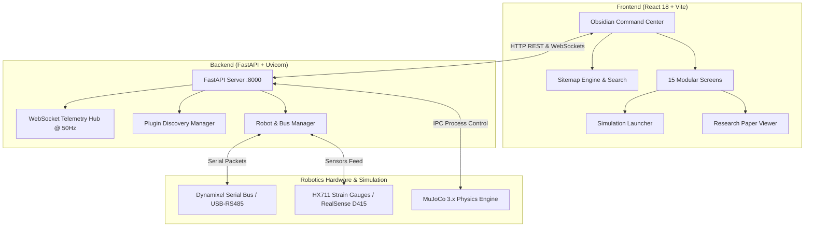

# OSRS: Open Source Robotics System

<div align="center">

[](https://github.com/BilalSabugar/OSRS/actions)
[](LICENSE)
[](https://www.python.org/)
[](https://react.dev/)
[](https://mujoco.org/)
[](AI_DISCLOSURE.md)
[](CONTRIBUTING.md)

**A modular, real-time command center, digital twin, and simulation suite for humanoid robotics, multi-DOF arms, and tactile ball-balancing research.**

[Features](#-key-features) • [Architecture](#-system-architecture) • [Quickstart](#-quickstart--installation) • [Simulations](#-mujoco-physics-simulations) • [Research Paper](#-research--publications) • [Safety](#-safety--hardware-disclaimer) • [Contributing](#-contributing)

</div>

---

> [!NOTE]
> ### 🤖 AI Collaboration & Development Notice
> **This project was built using AI-assisted programming workflows.**  
> Artificial Intelligence was leveraged to accelerate theoretical modeling, state-space derivations, mathematical LaTeX authoring, UI component modularization, and test suite generation under continuous human engineering direction and hardware safety validation. Read our full disclosure at **[AI_DISCLOSURE.md](AI_DISCLOSURE.md)**.

---

## 🌟 Overview

**OSRS (Open Source Robotics System)** is an integrated robotics platform bridging physical servo hardware (Robotis Dynamixel XL/XC/XM actuators), sensor perception pipelines, and high-fidelity **MuJoCo physics simulations** with an obsidian-themed reactive web command center.

Originally developed to solve high-speed cooperative plate balancing and tactile robotic perception, OSRS features a dynamic plugin-discovery architecture: developers can introduce custom robot kinematics, computer vision tracking algorithms, sensor arrays, or physics environments without altering core runtime loops.

```
OSRS/
├── src/                           # Core Runtime Engine
│   ├── core/                      # Server, Plugin Manager, Robot Manager, Telemetry Bus
│   └── modules/                   # Dynamically Discovered Hardware Extensions
│       ├── robots/                # Actuator configurations (Humanoid, LEAP Hand, OMX, Rover)
│       ├── perception/            # Vision trackers, RealSense depth, HX711 force sensing
│       ├── research/              # Control theory tasks (Dual-Arm Ball Balancer, RLS)
│       └── simulation/            # Digital twin and physics engine bridges
├── frontend/                      # Modular React + Vite Obsidian Web Dashboard
│   ├── src/screens/               # 15 Isolated Application Screen Components
│   ├── src/config/sitemap.js      # Centralized Sitemap Route & Search Architecture
│   └── src/components/            # Simulation Launcher, Research Paper Viewer, Dials
├── tests/                         # Pytest Automated Test Suite
├── omx_ball_manipulation/         # Stage 1: Dual OpenManipulator-X MuJoCo Simulation
├── two_arm_ball_manipulation/     # Stage 2: Asymmetric Franka FR3 + HEAL MuJoCo Simulation
├── simulation_ref/                # Stage 3: Humanoid (OP3) MuJoCo Physics Environments
├── load_cell_firmware/            # Embedded Arduino Uno / PlatformIO HX711 C++ Firmware
└── docs/                          # Comprehensive Technical Manuals & Research Papers
```

---

## 🚀 Key Features

- **Modular 15-Screen Architecture**: Deconstructed command center featuring isolated screens for Operations, 2D/3D Arm Dialing, Motion Choreography, Guided Zero-Point Calibration, Diagnostics Oscilloscope, and Computer Vision.
- **Hierarchical Sitemap Directory**: Built-in routing and search engine (`frontend/src/config/sitemap.js`) with category filtering, route badges, and a `Ctrl+K` Command Palette for instantaneous navigation.
- **1-Click MuJoCo Simulation Lab**: Launch interactive or headless physics benchmarks with dual-arm plate balancing, joint angle teleoperation, and live PID tuning directly from the browser.
- **Academic Research Paper Reader**: Embedded viewer for the peer-reviewed research paper, *"Toward Vision-Independent Tactile Robotic Perception"*, complete with LaTeX math, diagrams, and one-click PDF downloading.
- **Tactile Ball Balancer & RLS Identification**: Active plate balancing utilizing 2D strain-gauge load cells, fusing height-based kinematics with 50Hz online Recursive Least Squares (RLS) dynamic parameter identification.
- **Zero-Latency Telemetry Loop**: Broadcasts joint positions, velocity limits, 3D target coordinates, and load cell weights over 50Hz WebSockets to reactive visual dials.
- **Hardware Agnostic Plugins**: Supports multi-robot profiles including Humanoid Robot (16-DOF OP3 morphology), LEAP Hand (16-DOF biomimetic hand), OpenManipulator-X (5-DOF arm), and Rover Bot.

---

## 🏗️ System Architecture



---

## 📦 Quickstart & Installation

### Option 1: 1-Click Automated Setup (Windows)

Clone the repository and run the automated provisioning script:

```powershell
git clone https://github.com/BilalSabugar/OSRS.git
cd OSRS
.\setup.bat
```

`setup.bat` automatically:
1. Verifies prerequisites (**Python 3.10+** and **Node.js 18+**).
2. Provisions a virtual environment (`.venv`) and installs Python libraries (FastAPI, MuJoCo, PySerial, OpenCV, SciPy).
3. Installs frontend dependencies and compiles production assets (`npm run build`).
4. Launches the unified interactive menu (`launch.bat`).

---

### Option 2: Manual Installation (Cross-Platform)

#### 1. Backend Setup
```bash
# Clone the repository
git clone https://github.com/BilalSabugar/OSRS.git
cd OSRS

# Create and activate virtual environment
python -m venv .venv
source .venv/bin/activate  # On Windows: .venv\Scripts\activate

# Install dependencies
pip install -r requirements.txt
pip install pytest httpx
```

#### 2. Frontend Setup
```bash
cd frontend
npm install
npm run build   # Compiles production assets served by FastAPI
```

#### 3. Launch OSRS
```bash
# Return to root directory and start the server
python main.py
```
Open your browser to **`http://localhost:8000`** to access the OSRS Command Center.

---

## 🔬 MuJoCo Physics Simulations

OSRS integrates high-fidelity physics environments across three research development stages:

| Stage | Morphology | Directory | Description |
|:---:|:---|:---|:---|
| **Stage 1** | **Dual OpenManipulator-X** | [`omx_ball_manipulation/`](omx_ball_manipulation/) | Proved differential height kinematics ($\Delta z = L_p \sin	heta$) and solvePnP camera calibration. |
| **Stage 2** | **Franka FR3 + HEAL** | [`two_arm_ball_manipulation/`](two_arm_ball_manipulation/) | Scaled ball manipulation to heterogeneous industrial arms with 2D trajectory tracking. |
| **Stage 3** | **Humanoid OP3 Platform** | [`simulation_ref/`](simulation_ref/) | Full humanoid upper-body balancing with dual-arm plate linkages and load-cell sensor fusion. |

### Running from Terminal:
```bash
# Launch interactive Humanoid Plate Balancing simulation
python simulation_ref/simulate_humanoid.py --scene plate

# Run headless simulation benchmark
python simulation_ref/simulate_humanoid.py --headless --duration 10.0
```

*(You can also launch simulations with 1 click directly inside the web dashboard under the **Simulations** tab).*

---

## 📄 Research & Publications

OSRS serves as the software and experimental validation baseline for our research paper:

> **Toward Vision-Independent Tactile Robotic Perception: Dynamic Ball Balancing via Dual-Arm Multi-Axis Load-Cell State Fusion and Recursive Parameter Estimation**  
> *Author:* Bilal Sabugar  
> *Full Text:* **[docs/BALL_BALANCER_RESEARCH_PAPER.md](docs/BALL_BALANCER_RESEARCH_PAPER.md)**

```bibtex
@article{sabugar2026osrs,
  author    = {Bilal Sabugar},
  title     = {Toward Vision-Independent Tactile Robotic Perception: Dynamic Ball Balancing via Dual-Arm Multi-Axis Load-Cell State Fusion and Recursive Parameter Estimation},
  journal   = {Open Source Robotics Suite Technical Reports},
  year      = {2026},
  url       = {https://github.com/BilalSabugar/OSRS}
}
```

---

## 🧪 Automated Testing

OSRS maintains an automated test suite verifying robot kinematics profiles, API endpoints, and control loops:

```bash
# Run backend test suite
python -m pytest tests/ -v

# Verify frontend build integrity
cd frontend && npm run build
```

Continuous Integration is enforced on all pushes and pull requests via **GitHub Actions** (`.github/workflows/ci.yml`).

---

## 🛡️ Safety & Hardware Disclaimer

Operating physical robotic arms, high-current servomotors, and benchtop power supplies involves inherent mechanical and electrical hazards.

- **Emergency Stop (E-Stop)**: Press **`Alt + S`** in the web dashboard or click the **ESTOP** button to instantly release motor torque globally.
- **Simulation-First Principle**: Always validate novel motions in **Mock Mode** or **MuJoCo** prior to driving physical linkages.
- **Safety Policy**: Review our complete safety precautions at **[DISCLAIMER.md](DISCLAIMER.md)**.

---

## 🤝 Contributing

We welcome contributions from roboticists, researchers, and developers worldwide!

1. Read our **[Contributing Guide](CONTRIBUTING.md)** for environment setup and PR instructions.
2. Review our community standards in the **[Code of Conduct](CODE_OF_CONDUCT.md)**.
3. Report security vulnerabilities according to our **[Security Policy](SECURITY.md)**.
4. Review our transparent **[Privacy Policy](PRIVACY.md)** (100% local-first, zero cloud tracking).

---

## 📜 License

OSRS is open-source software licensed under the **[MIT License](LICENSE)**.
